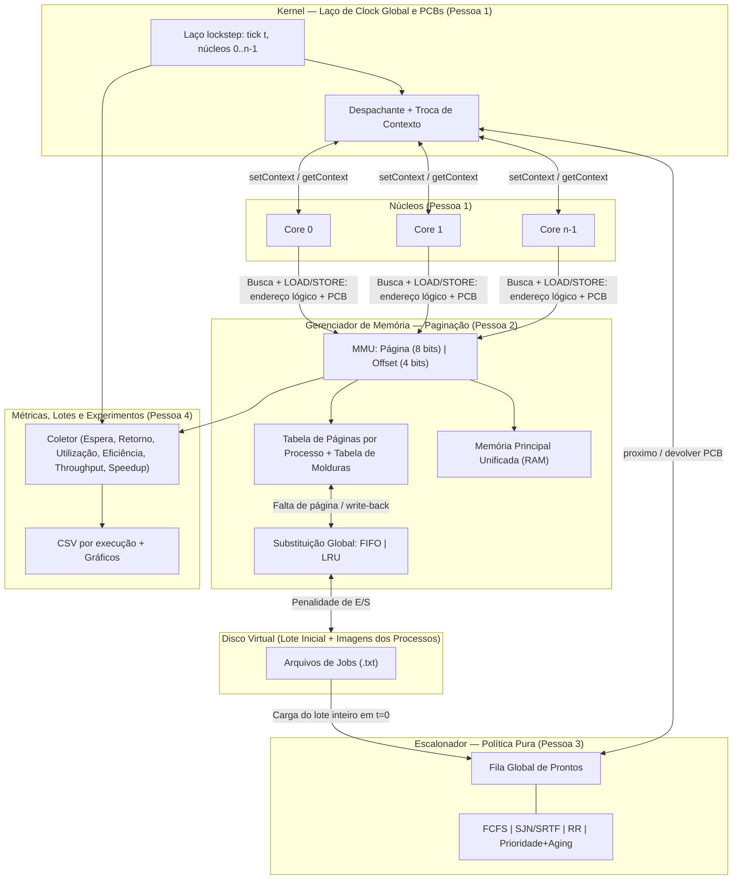

# Plano de Desenvolvimento — Simulador Multicore (Equipe de 4 Pessoas)

Este plano organiza a evolução do simulador *single-core* atual para a arquitetura **Multicore com Gerenciamento de Memória (Modelo Tanenbaum) e Escalonamento Dinâmico**, conforme exigido em [pratica.pdf](pratica.pdf), distribuindo tanto a **implementação em C++ (10 pts)** quanto o **Artigo Científico IEEE (10 pts)** entre **4 integrantes**.

A Seção 2 reúne os **contratos globais** (modelo de tempo, fatiamento de bits, semântica das políticas e definição das métricas). Eles devem ser fechados na Fase 1, porque todos os módulos e todas as seções do artigo dependem deles.

---

## 1. Visão Geral da Nova Arquitetura



> [!IMPORTANT]
> **Mudanças críticas em relação ao baseline:**
> 1. A [`ControlUnit`](src/cpu/control/control_unit.cpp) soma `OS_RESERVED_MEM` em `LOAD`, `STORE`, `BEQ` e `JUMP`, e o PC começa em 512 ([cpu.cpp](src/cpu/cpu.cpp) e [batch_manager.cpp](loader/batch_manager.cpp)). Com vários processos na memória, **o PC e todos os endereços passam a ser lógicos (começando em `0x000`)**, e **a busca de instrução (`fetch`) também passa pela MMU**.
> 2. [memory.cpp](src/memory.cpp) faz `clockGlobal++` a cada acesso, e existe um segundo relógio em [clock_core.cpp](loader/clock_core.cpp). Com vários núcleos, isso deixa o tempo inconsistente. Fica **um único relógio, do Kernel**, e cada núcleo contabiliza o próprio custo (Seção 2.1).
> 3. A classe `SistemaOperacional` ([so.cpp](src/so.cpp)) é **código morto**: compila, mas nunca é instanciada. O fluxo real está no `BatchManager`. O novo laço de clock fica num único lugar (Kernel, Pessoa 1), e o `BatchManager` passa a só montar a configuração e chamar o Kernel.

---

## 2. Contratos Globais (fechar na Fase 1)

### 2.1 Modelo de Execução e de Tempo

- **Determinismo:** a simulação roda em **uma única thread, em passo sincronizado (lockstep)**. Nada de `std::thread`, nada de aleatoriedade. A cada tick global `t`, os núcleos são percorridos sempre na ordem `0..n-1`. Empates do escalonador são desfeitos pelo menor PID.
- **Relógio único:** `uint64_t tick` pertence ao Kernel. O `clockGlobal++` de `LerMemoria`/`EscreverMemoria` e a duplicação com `ClockCore` são removidos.
- **Custo por instrução**, igual ao baseline para manter a comparação justa:
  - 1 ciclo de busca + 1 ciclo por acesso a dados (`LOAD`/`STORE`).
  - A instrução é executada funcionalmente no primeiro ciclo, e o núcleo fica ocupado por `custo − 1` ticks adicionais (`ciclosRestantes`).
- **Falta de página:** o **núcleo fica parado (*stall*)** por `PENALIDADE_FALTA` ciclos (padrão: 50, o mesmo custo de disco do baseline), mais `PENALIDADE_FALTA` se a moldura vítima estiver suja.
  - O processo continua `EXECUTANDO`. Não existe estado `BLOQUEADO`, porque bloquear seria uma interrupção e violaria o cenário não-preemptivo do PDF.
  - Os ciclos parados são contados separadamente (`ciclosStall`).
- **Troca de contexto:** custa `CUSTO_TROCA` ciclos (padrão: 5, configurável) e só é contada quando o **PID muda** no núcleo. Se o mesmo processo for escolhido de novo, não há custo.
- **Quantum:** medido em **ciclos de execução efetiva**. O tempo parado por falta de página não consome quantum. A preempção é verificada na **fronteira entre instruções**.
- **Proteção do lote:** o limite de instruções por processo (`LIMITE_INSTRUCOES_POR_JOB`) continua existindo. Estourar o limite, SEGFAULT ou opcode inválido leva o processo a `ABORTADO` sem derrubar o lote.
- **Parâmetros por linha de comando** (padrões entre parênteses):
  `--cores (4) --politica (fcfs|sjn|rr|prio) --modo (np|p) --quantum (10) --substituicao (fifo|lru) --molduras (16) --penalidade-falta (50) --custo-troca (5) --aging (50) --saida <dir>`

### 2.2 Memória: Paginação e Fatiamento de Bits

**Restrição do conjunto de instruções (ISA):** `LOAD`, `STORE` e `BEQ` têm **8 bits** de endereço e `JUMP` tem **12 bits** ([control_unit.cpp:42](src/cpu/control/control_unit.cpp:42)). Na prática, o espaço lógico de cada processo é de no máximo 4096 palavras, com dados restritos às primeiras 256. Páginas de 64 ou 256 palavras fariam cada job ocupar 1 página, e FIFO e LRU ficariam indistinguíveis. Por isso, usamos **páginas pequenas**:

| Endereço | Largura | Fatiamento | Resultado |
| :--- | :--- | :--- | :--- |
| **Lógico** | 12 bits (bits [15:12] devem ser 0, senão SEGFAULT) | `[11:4]` página (8 bits) \| `[3:0]` offset (4 bits) | até 256 páginas de **16 palavras** por processo; dados ficam nas páginas 0–15 |
| **Físico** | 16 bits (palavra de 16 bits, RAM de 64K) | `[15:4]` moldura (12 bits) \| `[3:0]` offset (4 bits) | 4096 molduras; **molduras 0–31 reservadas ao SO** (os 512 endereços de `OS_RESERVED_MEM`) |

- **Escassez forçada:** só `NUM_MOLDURAS_USUARIO` molduras (configurável: 4–32) ficam disponíveis para os processos, para provocar faltas de página e exercitar a substituição.
- **Paginação, não segmentação:** o PDF fala em "memória segmentada", mas descreve bloco de tamanho fixo + deslocamento + FIFO/LRU, que é paginação (Tanenbaum, cap. 3). No artigo, "bloco" = página de tamanho fixo, com a justificativa explícita. **Confirmar com o professor.**
- **Estruturas:**
  - **Tabela de páginas por processo, dentro do PCB**, com `valida`, `moldura`, `suja`, `referenciada`. Assim, trocar de contexto inclui trocar o ponteiro da tabela (equivalente ao PTBR).
  - **Tabela de molduras** (*core map*), com `livre`, `pid`, `pagina`, `carregadaEm`, `ultimoAcesso`, usada pela substituição.
- **Paginação sob demanda:** toda página começa inválida. A imagem do job fica no Disco Virtual, uma por PID. Páginas sujas são escritas de volta no disco quando substituídas.
- **Substituição global:** qualquer moldura de usuário pode ser vítima, de qualquer processo (Tanenbaum 3.5.1). Decisão registrada; substituição local fica como trabalho futuro.
  - **FIFO:** fila de molduras na ordem de carga.
  - **LRU exato:** `ultimoAcesso` recebe um **contador de acessos monotônico**, e não o tick, porque dois núcleos podem acessar a memória no mesmo tick e empatariam.
- **Rastreabilidade:** gravar a sequência de referências `(tick, core, pid, pagina, R/W)` em CSV. Isso permite calcular o **OPT de Belady** offline, como limite inferior, e verificar a **anomalia de Belady** no FIFO.

### 2.3 Semântica Política × Modo

Como **todos os processos chegam em t=0** e nenhum entra depois, a preempção por chegada de processo de maior prioridade **nunca acontece**. A única fonte de preempção é o fim do quantum. Sem uma definição explícita, várias células da matriz de experimentos dariam resultados idênticos. Esta tabela é a definição oficial (pseudocódigo de cada linha no artigo):

| Política | Não-Preemptivo | Preemptivo (quantum Q) | Observação para o artigo |
| :--- | :--- | :--- | :--- |
| **FCFS** | Ordem do lote (PID) | Ao esgotar Q, volta ao **fim** da fila → **equivale ao RR** | Silberschatz: "RR é FCFS com preempção". Equivalência assumida e discutida |
| **SJN** | Menor `estimativa` total | **SRTF**: menor tempo restante estimado, reavaliado a cada fim de quantum | Sem chegadas, SRTF ≈ SJN: o processo em execução continua sendo o mais curto. Resultado esperado, a ser explicado |
| **RR** | Q = ∞ → **equivale ao FCFS** | Fila circular com Q configurável | Silberschatz: com quantum muito grande, RR vira FCFS |
| **Prioridade** | Maior prioridade efetiva; desempate por PID | **RR entre mesma prioridade + envelhecimento (*aging*)**: a cada `--aging` ciclos na fila, prioridade efetiva +1; volta à base ao ser despachado | O *aging* evita inanição (Silberschatz 5.3.4) e cria preempção real |

- **Convenção:** **maior número = maior prioridade** (diretiva `.priority N`). Isso é o oposto do UNIX, então precisa estar explícito no artigo.
- **Estimativa para o SJN:** o tamanho estático (`instrucoes.size()`) **não** mede o tempo de CPU, porque laços multiplicam as instruções executadas. Usamos a diretiva `.estimate N` (instruções executadas), obtida por um **modo de perfilamento** (`--perfil`, que roda cada job sozinho com n=1 e memória folgada). Se a diretiva faltar, usa-se o tamanho estático com aviso no log. No batch clássico, o próprio usuário informa essa estimativa.
- **Multicore:** uma **fila global única de prontos**. Núcleos livres pegam o próximo processo na ordem `0..n-1`. Não há afinidade de processador, e migrar é gratuito porque não simulamos cache (Silberschatz 5.5; Tanenbaum 8.1.4). Decisão registrada no artigo.

### 2.4 Definição Formal das Métricas

Fechadas em conjunto pelas Pessoas 3 e 4, porque a "coleta exata de métricas" entra na nota de escalonamento. `N` = processos concluídos; `n` = núcleos; `makespan` = tick em que o último processo termina. Chegada = 0 para todos.

| Métrica | Definição |
| :--- | :--- |
| Tempo de retorno (*turnaround*) `TR_i` | `cicloFim_i − 0` |
| Tempo de espera `TE_i` | ciclos no estado `PRONTO`, sem contar stall nem troca de contexto |
| TME / TMR | média de `TE_i` / `TR_i` sobre os concluídos (abortados reportados à parte) |
| Ocupação do núcleo `k` | ciclos com processo alocado (execução + stall) + ciclos de troca de contexto |
| Utilização média da CPU | `Σ_k ocupado_k / (n × makespan)`; também reportar a **utilização útil** (só ciclos de execução) |
| Eficiência por núcleo `k` | `ocupado_k / makespan` (e versão útil) |
| Throughput global | `N / makespan` (apresentado em processos por 1.000 ciclos) |
| **Speedup** `S(n)` | `makespan(1) / makespan(n)` (Amdahl; Hennessy & Patterson) |
| **Eficiência paralela** `E(n)` | `S(n) / n` |
| Memória | acessos, acertos, faltas, taxa de faltas = faltas/acessos, write-backs (global e por processo) |
| Trocas de contexto | apenas as que mudam o PID no núcleo |

### 2.5 Baseline e Validação

- **Congelar o baseline:** `git tag v1-baseline 3351311`. O artigo compara contra essa versão, como o PDF pede, **e** contra o simulador novo com `--cores 1`, que é o controle experimental: isola o efeito do número de núcleos.
- **Teste de regressão:** com `--cores 1 --politica fcfs --modo np` e memória folgada, os 3 jobs atuais ([tests/](tests)) devem terminar com **registradores e memória iguais aos do baseline**. A diferença de ciclos deve ser explicada só pelas faltas de página × penalidade.
- **Oráculo do SJN:** com todos chegando em t=0 e estimativas exatas, o SJN não-preemptivo **minimiza o TMR** também em máquinas paralelas idênticas (regra SPT, Conway, Maxwell & Miller 1967). Se isso não acontecer, há bug ou a estimativa está errada.

---

## 3. Divisão de Responsabilidades entre as 4 Pessoas

Cada integrante é dono de um subsistema **e** da análise do experimento correspondente no artigo. Isso tira das costas da Pessoa 4 a discussão de resultados que não são dela.

| Integrante | Subsistema no Código | Arquivos (Novos / Modificados) | Responsabilidade no Artigo IEEE |
| :--- | :--- | :--- | :--- |
| **Pedro Henrique Galvão** | **Kernel (laço de clock), Multicore, PCB, Troca de Contexto, CLI e runner de benchmark** | `src/kernel.hpp/.cpp` *(novo)*, `src/pcb.hpp` *(novo)*, `src/config.hpp/.cpp` *(novo)*, [cpu.hpp](src/cpu/cpu.hpp), [cpu.cpp](src/cpu/cpu.cpp), [control_unit.cpp](src/cpu/control/control_unit.cpp), [main.cpp](main.cpp), `scripts/benchmark.sh` *(novo)*; remove [so.cpp](src/so.cpp) | Arquitetura multicore e modelo de tempo, PCB e troca de contexto, **Fluxograma Geral**, **Fundamentação Teórica / Trabalhos Relacionados**, análise do **E1 (speedup)** |
| **João Paulo** | **Gerenciamento de Memória (paginação + FIFO/LRU)** | [memory.hpp](src/memory.hpp), [memory.cpp](src/memory.cpp), `src/mmu.hpp/.cpp` *(novo)*, [ram_loader.cpp](loader/ram_loader.cpp), `scripts/opt_belady.py` *(novo)* | Metodologia de memória (fatiamento, tabelas, FIFO vs LRU), **Fluxograma da MMU**, análise do **E4 (faltas × molduras, OPT, Belady)** |
| **Igor Peixoto** | **Escalonador (política pura) e diretivas do job** | `src/scheduler.hpp/.cpp` *(novo)*, [parser.cpp](loader/parser.cpp) (`.priority`, `.estimate`), [clock_types.hpp](loader/clock_types.hpp) (`JobData`), modo `--perfil` | Metodologia de escalonamento, **tabela de semântica política × modo**, **pseudocódigos dos 4 escalonadores**, análise do **E2 (políticas)** e do **E3 (quantum)** |
| **Otávio Hiratsuka** | **Métricas, Exportação CSV, Lotes Experimentais e Gráficos** | [metrics.hpp](loader/metrics.hpp), [metrics.cpp](loader/metrics.cpp), [reporter.cpp](loader/reporter.cpp), `tests/lotes/` *(novo)*, `scripts/gerar_graficos.py` *(novo)*, alvo `benchmark` do [Makefile](Makefile) | **Introdução** (link do GitHub + compilação), **Resultados** (consolidação, E5), **Conclusão**, **Resumo**; revisão final de formatação |

**Regras de posse de arquivos (para evitar conflitos de merge):**
- [defines.hpp](src/defines.hpp): editado **só na Fase 1**, num único PR conjunto. Depois disso, cada constante tem um dono.
- [memory.hpp](src/memory.hpp)/[memory.cpp](src/memory.cpp): só a Pessoa 2. A Pessoa 1 nunca mexe neles; a `ControlUnit` acessa a memória pela interface definida na Fase 1.
- [batch_manager.cpp](loader/batch_manager.cpp): só a Pessoa 1. A Pessoa 3 entrega uma classe `Scheduler` **sem laço próprio**.
- **Referências:** um `.bib` compartilhado no Overleaf, e cada pessoa adiciona as que usar.

---

## 4. Detalhamento Técnico por Integrante

### 👤 Pessoa 1 — Kernel, Multicore, PCB e Troca de Contexto
**Objetivo:** transformar a máquina de 1 CPU em `n` núcleos em lockstep, capazes de pausar, salvar e retomar processos, com um único relógio.

1. **PCB (`src/pcb.hpp`):** reaproveita o `CPUContext` que já existe em [register_bank.hpp:25](src/cpu/registers/register_bank.hpp:25), sem duplicar `pc/ir/regs`.
   ```cpp
   enum class EstadoProcesso { NOVO, PRONTO, EXECUTANDO, FINALIZADO, ABORTADO };

   struct EntradaPagina { bool valida, suja, referenciada; uint16_t moldura; };

   struct PCB {
       int pid; std::string nomeArquivo; EstadoProcesso estado;
       CPUContext contexto; bool halted;                 // haltStatus da UC também é salvo
       int prioridadeBase, prioridadeEfetiva;
       uint32_t estimativa, instrucoesExecutadas, quantumUsado;
       std::vector<EntradaPagina> tabelaPaginas;         // preenchida pela MMU (Pessoa 2)
       uint64_t cicloInicio, cicloFim, ultimoEntrouPronto;
       uint64_t ciclosEspera, ciclosExecucao, ciclosStall;
       uint32_t trocasContexto, faltasPagina; int ultimoCore;
   };
   ```
2. **CPU:** adicionar `coreId`, `PCB* processoAtual` e `ciclosRestantes`; `salvarContexto(PCB&)` e `restaurarContexto(const PCB&)` usam `getContext()/setContext()` e incluem a flag de HALT da `ControlUnit`.
3. **ControlUnit:**
   - Remover o `+ OS_RESERVED_MEM` de `LOAD`/`STORE`/`BEQ`/`JUMP`.
   - Trocar as chamadas globais `LerMemoria/EscreverMemoria` (inclusive no `fetch`) por uma interface de barramento ligada ao processo do núcleo. Cada chamada devolve valor + ciclos de penalidade.
   - O PC inicial passa a ser `0`.
4. **Kernel (`src/kernel.cpp`):**
   - `std::vector<CPU> cores(n)` e o laço lockstep da Seção 2.1.
   - Despacho para núcleos livres, verificação de quantum na fronteira entre instruções e contabilização de `CUSTO_TROCA`.
   - Atualiza os contadores do PCB a cada tick: `ciclosEspera` de quem está `PRONTO`, `ciclosExecucao`/`ciclosStall` de quem está nos núcleos.
   - Remove os contadores globais (`clockGlobal`, `instExecutadas`, `acessosMemoria`) e unifica com o `ClockCore`.
5. **CLI e runner:** fazer o parsing dos argumentos da Seção 2.1 em [main.cpp](main.cpp) e criar `scripts/benchmark.sh`, que percorre a matriz de experimentos (Seção 6) e grava **um diretório por configuração**. O [reporter.cpp](loader/reporter.cpp) hoje abre o `output.dat` em modo de acréscimo, e execuções seguidas se misturariam.

### 👤 Pessoa 2 — Gerenciamento de Memória (Paginação, Modelo Tanenbaum)
**Objetivo:** fatiamento lógico 8+4 / físico 12+4, paginação sob demanda, substituição global FIFO e LRU (critério de 5 pontos).

1. **Constantes em [defines.hpp](src/defines.hpp)** (Fase 1):
   ```cpp
   const uint16_t BITS_OFFSET = 4, TAM_PAGINA = 1 << BITS_OFFSET;   // 16 palavras
   const uint16_t MASK_OFFSET = TAM_PAGINA - 1;
   const uint16_t MAX_END_LOGICO = 0x0FFF;                           // 12 bits
   const uint16_t MOLDURAS_SO = OS_RESERVED_MEM / TAM_PAGINA;        // 32
   inline uint16_t extrairPagina(uint16_t e) { return e >> BITS_OFFSET; }
   inline uint16_t extrairOffset(uint16_t e) { return e & MASK_OFFSET; }
   ```
2. **MMU provisória na Fase 1:** tradução fixa `físico = 512 + pid × 256 + lógico`, sem faltas de página. Ela segue a interface final, para que as Pessoas 1 e 3 integrem já na Fase 2 sem esperar a MMU real.
3. **Interface (`src/mmu.hpp`):**
   ```cpp
   struct ResultadoAcesso { uint16_t valor; uint32_t ciclosPenalidade; bool falta; };
   class MMU {
   public:
       MMU(PoliticaSubstituicao, uint32_t numMoldurasUsuario, uint32_t penalidadeFalta);
       void carregarProcesso(PCB&, const JobData&);   // imagem no Disco Virtual; páginas inválidas
       void liberarProcesso(PCB&);                    // devolve as molduras ao terminar/abortar
       ResultadoAcesso ler(PCB&, uint16_t endLogico, int coreId, uint64_t tick);
       ResultadoAcesso escrever(PCB&, uint16_t endLogico, uint16_t dado, int coreId, uint64_t tick);
   };
   ```
4. **Tradução:** endereço lógico > `0x0FFF` gera SEGFAULT. Página válida = acerto (atualiza `referenciada` e `ultimoAcesso`). Página inválida = falta: escolhe moldura livre ou vítima (FIFO/LRU), faz write-back se suja, carrega do disco e atualiza as duas tabelas.
5. **Métricas e rastro:** acessos, acertos, faltas e write-backs por processo e globais. O CSV da sequência de referências alimenta o `scripts/opt_belady.py` (OPT offline).
6. **[ram_loader.cpp](loader/ram_loader.cpp):** passa a montar a imagem do processo no Disco Virtual, sem gravar direto na RAM física. Remover também o `OS_RESERVED_MEM` redefinido localmente no arquivo.

### 👤 Pessoa 3 — Escalonador e Modos Preemptivo / Não-Preemptivo
**Objetivo:** implementar a tabela da Seção 2.3 (critério de 5 pontos, junto com as métricas).

1. **Carga determinística:** o lote inteiro é lido em t=0 e todos os PCBs são admitidos antes do primeiro tick. Nenhuma admissão depois disso (regra do PDF).
2. **Diretivas no [parser.cpp](loader/parser.cpp):** `.priority N` e `.estimate N`. Hoje qualquer linha não reconhecida é lida como instrução hexadecimal e gera erro. Adicionar os campos em `JobData`.
3. **Interface (`src/scheduler.hpp`)**, política pura, sem laço:
   ```cpp
   enum class Politica { FCFS, SJN, RR, PRIORIDADE };
   enum class Modo { NAO_PREEMPTIVO, PREEMPTIVO };
   class Scheduler {
   public:
       Scheduler(Politica, Modo, uint32_t quantum, uint32_t intervaloAging);
       void admitir(PCB*, uint64_t tick);
       PCB* proximo(uint64_t tick);                 // nullptr se a fila estiver vazia
       void devolver(PCB*, uint64_t tick);          // reinserção após preempção
       bool devePreemptar(const PCB& rodando) const;
       void envelhecer(uint64_t tick);              // só para Prioridade
       bool vazio() const;
   };
   ```
4. **Modo `--perfil`:** roda cada job isolado (n=1, memória folgada) e escreve no log o `.estimate` sugerido.
5. **Testes (`tests/test_scheduler.cpp`):**
   - Ordem de conclusão FCFS vs SJN.
   - Oráculo SPT (o SJN tem o menor TMR).
   - Preempção do RR com troca de contexto correta.
   - Desempate por PID.
   - *Aging* evitando inanição.
   - Equivalências FCFS-P ≡ RR-P e RR-NP ≡ FCFS-NP.

### 👤 Pessoa 4 — Métricas, Lotes Experimentais e Gráficos
**Objetivo:** coletar exatamente as métricas da Seção 2.4, criar cargas que estressem CPU e memória, e produzir os gráficos do artigo.

1. **Métricas ([metrics.hpp](loader/metrics.hpp)/[reporter.cpp](loader/reporter.cpp)):** estruturas por processo, por núcleo e globais (Seção 2.4). Exportar `processos.csv`, `nucleos.csv`, `resumo.csv` e um log legível em cada diretório `--saida`.
2. **Lotes experimentais (`tests/lotes/`):** 3 lotes de cerca de 10 jobs cada:
   - **CPU-bound:** laços longos, centenas a milhares de instruções executadas.
   - **Memory-bound:** variáveis espalhadas por várias páginas, por exemplo `0x40`, `0x80`, `0xC0`.
   - **Misto:** com prioridades e estimativas variadas.
   - Os jobs atuais (5–9 instruções) são curtos demais: com quantum de 5–20, RR vira FCFS. Ver as restrições da ISA na Seção 7.
3. **Alvo `make benchmark`:** chama o `scripts/benchmark.sh` (Pessoa 1) e depois o `scripts/gerar_graficos.py`, gerando PDF/PNG prontos para o template IEEE.

---

## 5. Cronograma (5 semanas até 06/12/2026)

A integração é **incremental**: o esqueleto completo roda já na Fase 2, com a MMU provisória, e não só na Fase 3. A escrita do artigo começa na Fase 2.

| Fase | Período | Meta | Marco de Sincronização |
| :--- | :--- | :--- | :--- |
| **F1 — Contratos** | 02/11 – 08/11 | Seção 2 aprovada pela equipe; `pcb.hpp`, `defines.hpp`, `mmu.hpp`, `scheduler.hpp` e a interface de barramento compilando; MMU provisória; tag `v1-baseline` | **M1 (08/11):** `make` compila com os novos cabeçalhos |
| **F2 — Módulos** | 09/11 – 22/11 | P1: Kernel lockstep + troca de contexto · P2: MMU real FIFO/LRU · P3: 4 políticas × 2 modos + diretivas · P4: métricas CSV + 3 lotes · Fundamentação e Metodologia no Overleaf | **M2 (15/11):** esqueleto com n núcleos + FCFS-NP + MMU provisória e teste de regressão contra o baseline passando · **M3 (22/11):** `make test_mmu test_scheduler test_multicore` passando |
| **F3 — Integração e Experimentos** | 23/11 – 29/11 | MMU real no Kernel; perfilamento dos lotes; execução da matriz da Seção 6 | **M4 (29/11):** CSVs + gráficos gerados por `make benchmark` |
| **F4 — Artigo** | 30/11 – 05/12 | Resultados, discussão de cada experimento (pelo dono do subsistema), Conclusão, Resumo, revisão cruzada | **M5 (05/12):** PDF final + repositório público documentado; 06/12 fica de folga para a entrega no AVA |

---

## 6. Experimentos Planejados

| Exp. | Pergunta | Variáveis | Gráfico | Dono da análise |
| :--- | :--- | :--- | :--- | :--- |
| **E1** | Quanto o multicore ganha sobre o single-core? | `cores ∈ {1, 2, 4, 8}` × 4 políticas × 2 modos; + baseline `v1` | Speedup `S(n)`, eficiência `E(n)` e throughput × n | Pessoa 1 |
| **E2** | Como as políticas se comparam? | 4 políticas × 2 modos, `n ∈ {1, 4}`, 3 lotes | TME e TMR por política (barras agrupadas) | Pessoa 3 |
| **E3** | Qual o efeito do quantum? | `Q ∈ {2, 5, 10, 20, 50, 100}` × `custo-troca ∈ {0, 5}` (RR e Prioridade) | TMR e % de sobrecarga de troca × Q | Pessoa 3 |
| **E4** | FIFO vs LRU: há anomalia de Belady? | `molduras ∈ {4, 6, 8, 12, 16, 24, 32}` × {FIFO, LRU, OPT offline} | Faltas × molduras | Pessoa 2 |
| **E5** | Como a carga se distribui entre os núcleos? | n = 4, todas as políticas | Eficiência por núcleo (barras) e linha do tempo de ocupação | Pessoa 4 |

**Hipóteses a discutir com a literatura:**
- **E2:** o SJN minimiza o TMR (SPT), mas pode **piorar o makespan e a eficiência dos núcleos**, porque o job longo começa por último e deixa núcleos ociosos no final. Graham (1966) prova o limite de 2 − 1/m para escalonamento por lista, e LPT é melhor para makespan (Graham, 1969).
- **E3:** quantum pequeno aumenta a sobrecarga de troca. Exemplo do Tanenbaum: com troca de 1 ms, quantum de 4 ms desperdiça 20% e quantum de 100 ms desperdiça 1%. Regra prática: Q maior que cerca de 80% das rajadas (Silberschatz).
- **E4:** LRU é um algoritmo de pilha e não sofre a anomalia de Belady (Mattson et al., 1970); o FIFO pode sofrer (Belady, Nelson & Shedler, 1969). O OPT dá o limite inferior (Belady, 1966).

---

## 7. Restrições da ISA para Escrever os Jobs

- **BEQ:** o campo de endereço (`IR & 0xFF`) **se sobrepõe ao registrador `regF1`** ([control_unit.cpp:39](src/cpu/control/control_unit.cpp:39)). O nibble alto do destino é, obrigatoriamente, o número do registrador comparado. Comparando com R0, só dá para saltar para `0x00–0x0F`. Para sair de laços longos, usar um **trampolim** (BEQ para um `JUMP` posicionado no início do código).
- **Sem endereçamento indireto ou imediato:** não dá para percorrer vetores, e os endereços acessados são fixos no código. Para estressar a MMU, espalhar variáveis e código por várias páginas de 16 palavras.
- **Dados só em `0x00–0xFF`** (8 bits); código pode ir até `0xFFF` via `JUMP`.

---

## 8. Pendências para Confirmar com o Professor

1. Aceita **paginação** como interpretação de "memória segmentada / bloco + deslocamento"?
2. A comparação com o baseline pode usar a tag `v1-baseline` **e** o simulador novo com `--cores 1`?
3. Aceita assumir as equivalências **FCFS-P ≡ RR** e **RR-NP ≡ FCFS**, discutidas no artigo, em vez de inventar variantes artificiais?

---

## 9. Referências Base

- A. S. Tanenbaum e H. Bos, *Modern Operating Systems*, 4ª ed., Pearson, 2015 — cap. 2.4 (escalonamento), cap. 3 (paginação; 3.4 substituição; 3.5.1 local × global; 3.5.3 tamanho de página), 8.1.4 (escalonamento em multiprocessadores).
- A. Silberschatz, P. B. Galvin e G. Gagne, *Operating System Concepts*, 10ª ed., Wiley, 2018 — cap. 5 (5.3 algoritmos; 5.5 multiprocessadores) e cap. 10 (memória virtual).
- R. H. Arpaci-Dusseau e A. C. Arpaci-Dusseau, *Operating Systems: Three Easy Pieces*, 2018 — caps. 7–10 e 22.
- L. A. Belady, "A study of replacement algorithms for a virtual-storage computer", *IBM Systems Journal*, 5(2), 1966.
- L. A. Belady, R. A. Nelson e G. S. Shedler, "An anomaly in space-time characteristics of certain programs running in a paging machine", *Communications of the ACM*, 12(6), 1969.
- R. L. Mattson, J. Gecsei, D. R. Slutz e I. L. Traiger, "Evaluation techniques for storage hierarchies", *IBM Systems Journal*, 9(2), 1970.
- P. J. Denning, "The working set model for program behavior", *Communications of the ACM*, 11(5), 1968.
- R. L. Graham, "Bounds for certain multiprocessing anomalies", *Bell System Technical Journal*, 45(9), 1966; "Bounds on multiprocessing timing anomalies", *SIAM J. Applied Mathematics*, 17(2), 1969.
- R. W. Conway, W. L. Maxwell e L. W. Miller, *Theory of Scheduling*, Addison-Wesley, 1967.
- G. M. Amdahl, "Validity of the single processor approach to achieving large scale computing capabilities", *AFIPS Conf. Proc.*, 1967.
- J. L. Hennessy e D. A. Patterson, *Computer Architecture: A Quantitative Approach*, 6ª ed., Morgan Kaufmann, 2017.
